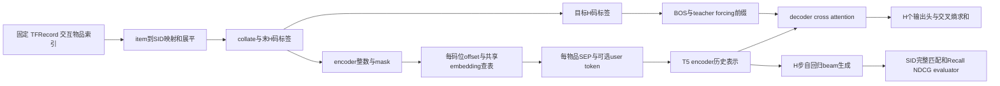

# Baseline 阅读总图

## 先用一条数据理解流程

`TEACHING_EXAMPLE`：假设用户历史有物品 A、B，待预测物品 C；人为设 A 的四位 SID 为 `[2,7,1,0]`，B 为 `[5,3,4,1]`。这些数字不是实际 checkpoint、用户或物品观测。物品 ID 是 SID 表的列索引；四位 SID 是四个离散码位；推荐模型的可训练 embedding 是另一张表。

`SOURCE_FACT`：图对应 `pre_processing.map_sparse_id_to_semantic_id`、`collate_fn_train`、`NextKTokenMasking.transform_label`、`SemanticIDEncoderDecoder.{encoder_forward_pass,decoder_forward_pass,model_step,generate}` 和 `SIDRetrievalEvaluator.__call__`。下方源码证据表列出各自完整身份和行范围。

## 固定入口与配置链

`HISTORICAL_OBSERVATION`：baseline 来源为 `/home/jcyin/GRID_wmh_Qwen_TIGER_20261009`；原运行目录、job argv、`.hydra/{config,overrides,hydra}.yaml` 和结果保留原路径。Beauty 最佳 step012500，Toys006200，Sports009500，选择依据是固定 `Baseline Results/test_results.json` 与对应 stage_result 的 checkpoint 字段，而非文件名相似或任意 last。

`SOURCE_FACT`：历史 `_运行/run_tiger_job.py` 读取显式 job 的 `argv`；其中 `_运行/grid_stage.py` 用 `@hydra.main(config_path='../configs', config_name='train')` 进入 `pipeline_launcher`。`initialize_pipeline_modules` 依次调用 Hydra instantiate 创建 datamodule、模型、callbacks、logger、Trainer。`grid_stage` 在训练分支 fit 后读取 `checkpoint_callback.best_model_path`，再把该路径交给 test。**这里是在阅读既有代码，本阶段没有调用这些函数。**

`CONFIG_DECLARATION`：阅读模板是 `configs/train.yaml` 的 defaults → callbacks/logger/trainer/paths/extras/hydra → experiment override → 原 overrides → 保存的完整 config。三域原记录普通文本入口在 `manifests/sid-extensions/baseline-run-records/<dataset>/`。TIGER target 为 `src.models.modules.semantic_id.tiger_generation_model.SemanticIDEncoderDecoder`。当前已保存配置声明 H=4、sequence_length=120、T5 d_model=128、num_user_bins=null、CrossEntropyLoss、Adam；不是加载 checkpoint 测得的结构。

`SOURCE_FACT`：`custom_hydra_resolvers.py` 注册 `math_eval`、`conditional_expression` 等 resolver；配置中的 `torch.load` target 用于读取 SID。不能为了“只解析配置”调用 instantiate 或 resolver 链；本阶段只读取原文。`codex/test_saved_checkpoint.py --validate-only` 正文仍实例化模型并 torch.load，因此也没有执行。

`HISTORICAL_OBSERVATION`：原命令证据是各域 `command_val1600.json` 的完整 argv；必须以它和保存 YAML 为准。后续命令形状仅供解释：`python _运行/grid_stage.py experiment=tiger_train_flat <data_dir> <semantic_id_path> <overrides>`。此处省略号/占位符不能直接启动；本阶段未写自动实验流水线。

## 从文件到模型

|环节|正文行为与意义|性质|
|---|---|---|
|文件划分|训练 `training/`，验证 `evaluation/`，测试 `testing/`，物品信息 `items/`；具体枚举来自固定清单，不重新划分|CONFIG_DECLARATION|
|读取|`TFRecordIterator` 用 GZIP TFRecord；`UnboundedSequenceIterable` 按配置的 preprocess 列表处理行；不要把“文件存在”当 loader 已验证|SOURCE_FACT|
|item→SID|`id_map[:H].t()[v].view(-1)`；表原约定 H×N，v 是数据物品索引，展平成物品优先的 H 码整数序列|SOURCE_FACT|
|训练 collate|尝试枚举连续子序列并抽样，再调用普通 collate；计数表达式与枚举范围存在静态疑点，不能声称精确均匀采样 128 条|SOURCE_FACT / STATIC_INFERENCE|
|标签|`NextKTokenMasking` 保存末 H 码为 labels，把目标组改成 masking/padding。原配置两者都为 -1；随后 mask 区分有效位置|SOURCE_FACT / CONFIG_DECLARATION|
|offset|每物品码位 j 加 j×U；被 mask 的位置乘 0 后安全查表，mask 仍传给 encoder；U 是每码位推荐词表宽度|SOURCE_FACT|
|encoder|先共享表查出 E 维向量，每 H 个向量后加一个可训练 SEP；SEP 的 mask 复制该组末码位；可选 user token 仅在 user_id 和 user_embedding 都存在时加|SOURCE_FACT|
|decoder训练|BOS 前置到目标码向量；causal decoder 看到真实前缀。去掉最后一个表示，H 个 decoder_mlp 线性输出头各计算交叉熵并求和|SOURCE_FACT|
|decoder生成|H 次循环，每次使用此前生成 SID 和 KV cache；按概率乘积筛 beam，必要时过滤不合法 SID 前缀并 reorder cache|SOURCE_FACT|
|evaluator|generated_ids `[B,K,H]` 与 labels `[B,1,H]` 按全部 H 位相等判断命中，使用候选概率和 sample index 更新 Recall/NDCG|SOURCE_FACT|

`SOURCE_FACT`：此文件的变量 `codebooks` 是缓存 item→SID 整数映射（构造后转为 N×H 用于前缀检查）；它不是上游残差量化器的向量码本，也不是推荐模型的 `item_sid_embedding_table_encoder`。普通模型的 `get_embedding_table('encoder')` 和 `('decoder')` 都返回同一表；共享关系由正文确定，不能只凭 `weight_tying:true` 字样。

## 张量与参数的静态读法

设 L=H×M 是 padded SID 槽长度，E 是推荐表示维度，U 是推荐每码位词表宽度。`STATIC_INFERENCE`：整数 `[B,L]` 和 mask `[B,L]` → lookup `[B,L,E]` → 带 SEP `[B,M(H+1),E]` → encoder 同长度表示。user token 启用时再加一槽。标签 `[B,H]` → teacher 输入 `[B,H+1,E]` →用于 loss 的 `[B,H,E]` →每码位 `[B,U]` logits。生成返回 `[B,K,H]` 与 `[B,K]` 候选分数。

`CONFIG_DECLARATION + STATIC_INFERENCE`：H4/E128/L120 对应 M30 个物品槽，无 user token且有 SEP时 encoder150槽。它们可能含被隐藏的目标槽和 padding，**不等于 30 个有效历史物品**。这些尺寸没有通过 checkpoint 加载或前向观察。U 的实际值依赖 SID 内容；本阶段不反序列化 SID 来宣称实测。

`SOURCE_FACT + STATIC_INFERENCE`：普通 SID embedding 有 HUE 参数，BOS 有 E，SEP 启用时 E，H 个无 bias 输出头合计 HEU；user table 只有启用时才存在。理论梯度经 loss→decoder/encoder→共享表、BOS、SEP。`BaseModule.configure_optimizers` 把 `self.trainer.model.parameters()` 全部交给配置优化器，没有显式 requires_grad 过滤；冻结参数通常不产生梯度，这与从优化器参数列表移除是两件事。具体冻结、初始化和恢复训练状态须按真实 config/后续授权检查；不能把可求导推导说成实际梯度测量。

`SOURCE_FACT`：beam 代码 softmax 后累乘概率；`marginal_log_prob` 名字不表示 log-space，不能讲成 log 概率相加。`should_check_prefix`、K、cache 类型和 evaluator Top-K 都是未来预跑需要确认的接口边界。

## 历史证据与接下来只讨论什么

`HISTORICAL_OBSERVATION`：固定 baseline 有三域历史结果，标签为 `HISTORICAL_REPORTED_NOT_RERUN`。`archive_validation.json` 记录了旧发布阶段 CPU strict load，但没有逐项绑定当前全部资产 hash 的语义证明；ASSET_MANIFEST 因此区分 provenance 与 `SEMANTIC_BINDING_UNVERIFIED`。旧 v6 CPU 检查只覆盖旧普通模型的有界合成接口，不覆盖当前三域/Shuffle/完整 Trainer。

`PROPOSED_NOT_IMPLEMENTED`：未来先核实际 import 身份、数据 item轴/SID、最佳 checkpoint 和配置的配对，再做最小兼容/shape/mask/梯度检查；之后才讨论完整评测。当前只列验证目标，没有执行 loader 或模型。用户首先需要能指出“物品列索引、SID整数、offset后索引、推荐embedding向量、目标码”各是什么，再决定 Shuffle/MLP 的公平比较范围。

## 冻结源码证据

本表的行号由实际发布字节核对；源码集合身份 `8b3149a98731ba7857e446e0f488489be0715181b841f8c7f9f169d3c4e16ac3`。baseline链接固定完整SHA；原件链接在CONTENT_COMMIT发布后由交付元数据绑定该完整SHA，原始捕获版本和每文件完整SHA始终保留。

|文件/符号/实际行范围|版本|源SHA-256|
|---|---|---|
|[GRID baseline/_运行/run_tiger_job.py::(全文) L1–57](https://github.com/woobowen/recommend/blob/563dc50b1c7e9e2e05cdfddd13e91a3d1888001e/GRID%20baseline/_%E8%BF%90%E8%A1%8C/run_tiger_job.py#L1-L57)|`563dc50b1c7e9e2e05cdfddd13e91a3d1888001e`|`8b5720946a75240d7b3675b3778a065aa86e8235f08c8b6151a6567dd1328e0d`|
|[GRID baseline/_运行/grid_stage.py::main L58–78](https://github.com/woobowen/recommend/blob/563dc50b1c7e9e2e05cdfddd13e91a3d1888001e/GRID%20baseline/_%E8%BF%90%E8%A1%8C/grid_stage.py#L58-L78)|`563dc50b1c7e9e2e05cdfddd13e91a3d1888001e`|`7881cd34619112a1acd84ff5e1ec3f00143966009e3f143a72f0f560efe0f282`|
|[GRID baseline/src/utils/launcher_utils.py::initialize_pipeline_modules L108–172](https://github.com/woobowen/recommend/blob/563dc50b1c7e9e2e05cdfddd13e91a3d1888001e/GRID%20baseline/src/utils/launcher_utils.py#L108-L172)|`563dc50b1c7e9e2e05cdfddd13e91a3d1888001e`|`49cb7af22596e6215848708cba4ef06a1032e3051ae38681524eb7fc45399837`|
|[GRID baseline/configs/train.yaml::(全文) L1–45](https://github.com/woobowen/recommend/blob/563dc50b1c7e9e2e05cdfddd13e91a3d1888001e/GRID%20baseline/configs/train.yaml#L1-L45)|`563dc50b1c7e9e2e05cdfddd13e91a3d1888001e`|`358c400a26a9bf8cbb231470200e06f0e5b9e15dba3a301bbe48ad73c1ed19e7`|
|[GRID baseline/configs/experiment/tiger_train_flat.yaml::(全文) L1–340](https://github.com/woobowen/recommend/blob/563dc50b1c7e9e2e05cdfddd13e91a3d1888001e/GRID%20baseline/configs/experiment/tiger_train_flat.yaml#L1-L340)|`563dc50b1c7e9e2e05cdfddd13e91a3d1888001e`|`d5a78dbbe25f39c894d34bc2d5b70e621cc8e45de41be5163da093a5ea37d890`|
|[GRID baseline/src/data/loading/components/iterators.py::TFRecordIterator L105–228](https://github.com/woobowen/recommend/blob/563dc50b1c7e9e2e05cdfddd13e91a3d1888001e/GRID%20baseline/src/data/loading/components/iterators.py#L105-L228)|`563dc50b1c7e9e2e05cdfddd13e91a3d1888001e`|`8b59b319ea9c05da504e483f4e20b9ea464ff723b9cc00c3c2b78e8d4203295f`|
|[GRID baseline/src/data/loading/components/dataloading.py::UnboundedSequenceIterable L85–163](https://github.com/woobowen/recommend/blob/563dc50b1c7e9e2e05cdfddd13e91a3d1888001e/GRID%20baseline/src/data/loading/components/dataloading.py#L85-L163)|`563dc50b1c7e9e2e05cdfddd13e91a3d1888001e`|`b01e09751878fefeb276092897ce69c2a4e89540284fc765bcb82e839ecf1282`|
|[GRID baseline/src/data/loading/components/pre_processing.py::map_sparse_id_to_semantic_id L120–149](https://github.com/woobowen/recommend/blob/563dc50b1c7e9e2e05cdfddd13e91a3d1888001e/GRID%20baseline/src/data/loading/components/pre_processing.py#L120-L149)|`563dc50b1c7e9e2e05cdfddd13e91a3d1888001e`|`31f89a77b4881c1130f83e1572b25fe273de1e641855d6a199cd0b9a84984391`|
|[GRID baseline/src/data/loading/components/collate_functions.py::collate_with_sid_causal_duplicate L20–116](https://github.com/woobowen/recommend/blob/563dc50b1c7e9e2e05cdfddd13e91a3d1888001e/GRID%20baseline/src/data/loading/components/collate_functions.py#L20-L116)|`563dc50b1c7e9e2e05cdfddd13e91a3d1888001e`|`a4692ce68705ea6a10ed500245f5c5acc99468f7e5d3f2d41e1ff0970fa9a73c`|
|[GRID baseline/src/data/loading/components/collate_functions.py::collate_fn_train L188–279](https://github.com/woobowen/recommend/blob/563dc50b1c7e9e2e05cdfddd13e91a3d1888001e/GRID%20baseline/src/data/loading/components/collate_functions.py#L188-L279)|`563dc50b1c7e9e2e05cdfddd13e91a3d1888001e`|`a4692ce68705ea6a10ed500245f5c5acc99468f7e5d3f2d41e1ff0970fa9a73c`|
|[GRID baseline/src/data/loading/components/label_function.py::NextKTokenMasking.transform_label L120–196](https://github.com/woobowen/recommend/blob/563dc50b1c7e9e2e05cdfddd13e91a3d1888001e/GRID%20baseline/src/data/loading/components/label_function.py#L120-L196)|`563dc50b1c7e9e2e05cdfddd13e91a3d1888001e`|`1cf9968416723a87bb77f54e53cc0d3143e2e4bd4f7ebde103e0878ef9f020c7`|
|[GRID baseline/src/models/modules/semantic_id/tiger_generation_model.py::SemanticIDGenerativeRecommender._add_repeating_offset_to_rows L162–200](https://github.com/woobowen/recommend/blob/563dc50b1c7e9e2e05cdfddd13e91a3d1888001e/GRID%20baseline/src/models/modules/semantic_id/tiger_generation_model.py#L162-L200)|`563dc50b1c7e9e2e05cdfddd13e91a3d1888001e`|`c61606b4a03d6fc8cfa6cb3bca093a36bbf9a1846334d39cb8dbcb67b32c296e`|
|[GRID baseline/src/models/modules/semantic_id/tiger_generation_model.py::SemanticIDGenerativeRecommender._inject_sep_token_between_sids L79–131](https://github.com/woobowen/recommend/blob/563dc50b1c7e9e2e05cdfddd13e91a3d1888001e/GRID%20baseline/src/models/modules/semantic_id/tiger_generation_model.py#L79-L131)|`563dc50b1c7e9e2e05cdfddd13e91a3d1888001e`|`c61606b4a03d6fc8cfa6cb3bca093a36bbf9a1846334d39cb8dbcb67b32c296e`|
|[GRID baseline/src/models/modules/semantic_id/tiger_generation_model.py::SemanticIDEncoderDecoder.__init__ L467–582](https://github.com/woobowen/recommend/blob/563dc50b1c7e9e2e05cdfddd13e91a3d1888001e/GRID%20baseline/src/models/modules/semantic_id/tiger_generation_model.py#L467-L582)|`563dc50b1c7e9e2e05cdfddd13e91a3d1888001e`|`c61606b4a03d6fc8cfa6cb3bca093a36bbf9a1846334d39cb8dbcb67b32c296e`|
|[GRID baseline/src/models/modules/semantic_id/tiger_generation_model.py::SemanticIDEncoderDecoder.encoder_forward_pass L584–659](https://github.com/woobowen/recommend/blob/563dc50b1c7e9e2e05cdfddd13e91a3d1888001e/GRID%20baseline/src/models/modules/semantic_id/tiger_generation_model.py#L584-L659)|`563dc50b1c7e9e2e05cdfddd13e91a3d1888001e`|`c61606b4a03d6fc8cfa6cb3bca093a36bbf9a1846334d39cb8dbcb67b32c296e`|
|[GRID baseline/src/models/modules/semantic_id/tiger_generation_model.py::SemanticIDEncoderDecoder.decoder_forward_pass L661–736](https://github.com/woobowen/recommend/blob/563dc50b1c7e9e2e05cdfddd13e91a3d1888001e/GRID%20baseline/src/models/modules/semantic_id/tiger_generation_model.py#L661-L736)|`563dc50b1c7e9e2e05cdfddd13e91a3d1888001e`|`c61606b4a03d6fc8cfa6cb3bca093a36bbf9a1846334d39cb8dbcb67b32c296e`|
|[GRID baseline/src/models/modules/semantic_id/tiger_generation_model.py::SemanticIDEncoderDecoder.get_embedding_table L863–884](https://github.com/woobowen/recommend/blob/563dc50b1c7e9e2e05cdfddd13e91a3d1888001e/GRID%20baseline/src/models/modules/semantic_id/tiger_generation_model.py#L863-L884)|`563dc50b1c7e9e2e05cdfddd13e91a3d1888001e`|`c61606b4a03d6fc8cfa6cb3bca093a36bbf9a1846334d39cb8dbcb67b32c296e`|
|[GRID baseline/src/models/modules/semantic_id/tiger_generation_model.py::SemanticIDEncoderDecoder.model_step L900–953](https://github.com/woobowen/recommend/blob/563dc50b1c7e9e2e05cdfddd13e91a3d1888001e/GRID%20baseline/src/models/modules/semantic_id/tiger_generation_model.py#L900-L953)|`563dc50b1c7e9e2e05cdfddd13e91a3d1888001e`|`c61606b4a03d6fc8cfa6cb3bca093a36bbf9a1846334d39cb8dbcb67b32c296e`|
|[GRID baseline/src/models/modules/semantic_id/tiger_generation_model.py::SemanticIDEncoderDecoder.generate L738–827](https://github.com/woobowen/recommend/blob/563dc50b1c7e9e2e05cdfddd13e91a3d1888001e/GRID%20baseline/src/models/modules/semantic_id/tiger_generation_model.py#L738-L827)|`563dc50b1c7e9e2e05cdfddd13e91a3d1888001e`|`c61606b4a03d6fc8cfa6cb3bca093a36bbf9a1846334d39cb8dbcb67b32c296e`|
|[GRID baseline/src/models/modules/semantic_id/tiger_generation_model.py::SemanticIDGenerativeRecommender._beam_search_one_step L253–372](https://github.com/woobowen/recommend/blob/563dc50b1c7e9e2e05cdfddd13e91a3d1888001e/GRID%20baseline/src/models/modules/semantic_id/tiger_generation_model.py#L253-L372)|`563dc50b1c7e9e2e05cdfddd13e91a3d1888001e`|`c61606b4a03d6fc8cfa6cb3bca093a36bbf9a1846334d39cb8dbcb67b32c296e`|
|[GRID baseline/src/components/eval_metrics.py::SIDRetrievalEvaluator.__call__ L307–386](https://github.com/woobowen/recommend/blob/563dc50b1c7e9e2e05cdfddd13e91a3d1888001e/GRID%20baseline/src/components/eval_metrics.py#L307-L386)|`563dc50b1c7e9e2e05cdfddd13e91a3d1888001e`|`36881aa8349b07c83eda8e0d45ea495ee213f5022403ecb7490b3fab7e66c5bb`|
|[GRID baseline/src/models/modules/base_module.py::BaseModule.configure_optimizers L168–189](https://github.com/woobowen/recommend/blob/563dc50b1c7e9e2e05cdfddd13e91a3d1888001e/GRID%20baseline/src/models/modules/base_module.py#L168-L189)|`563dc50b1c7e9e2e05cdfddd13e91a3d1888001e`|`029dc55aa499147c55a915c9523291c6b331076afb5cd7a18459968aaff16b73`|
|[GRID baseline/src/utils/custom_hydra_resolvers.py::(全文) L1–168](https://github.com/woobowen/recommend/blob/563dc50b1c7e9e2e05cdfddd13e91a3d1888001e/GRID%20baseline/src/utils/custom_hydra_resolvers.py#L1-L168)|`563dc50b1c7e9e2e05cdfddd13e91a3d1888001e`|`d26096e30efdfff7425ab1bb146f0277b1efd933356610b8223be5d5715bf72a`|
|[GRID baseline/codex/test_saved_checkpoint.py::main L12–72](https://github.com/woobowen/recommend/blob/563dc50b1c7e9e2e05cdfddd13e91a3d1888001e/GRID%20baseline/codex/test_saved_checkpoint.py#L12-L72)|`563dc50b1c7e9e2e05cdfddd13e91a3d1888001e`|`37dd74d7219b7d8afcc916d1c754f9043c2171960f0bbe4b71df2aab9cefd274`|

